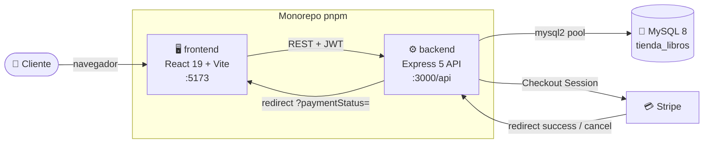
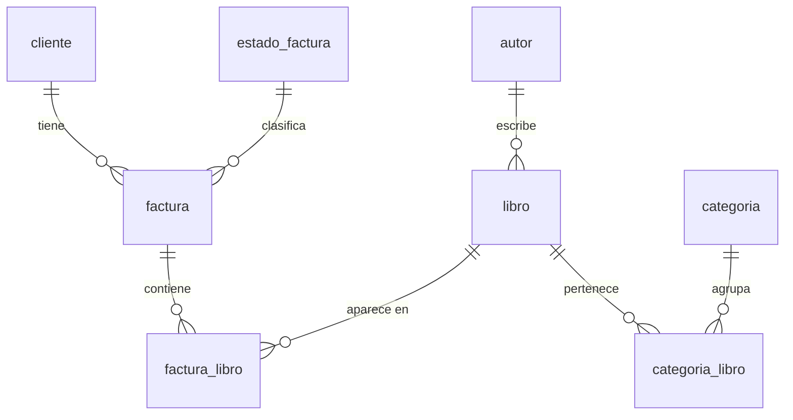
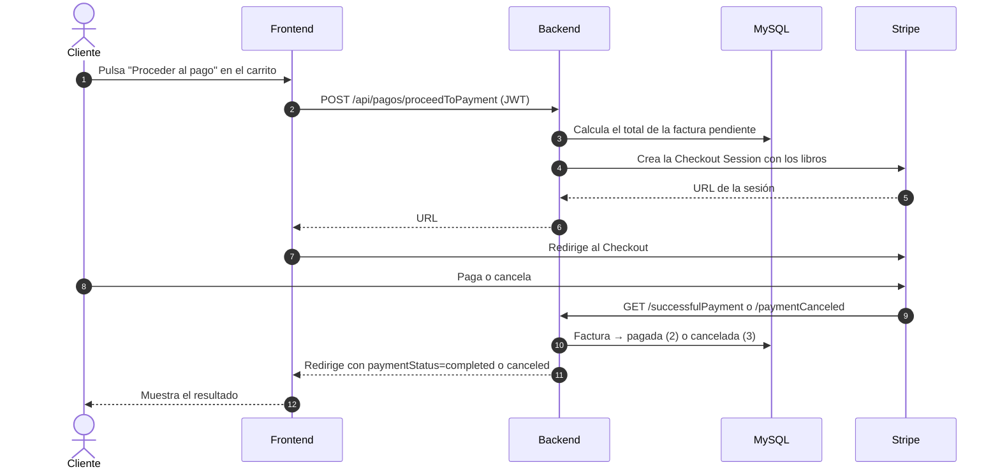

<div align="center">


# Tienda de Libros · E-commerce con Stripe

Tienda en línea de libros con catálogo, búsqueda, carrito de compras, autenticación con JWT y pagos con **Stripe Checkout**.


<!-- CI: reemplazar por el badge del pipeline de AWS cuando exista -->
<!-- CD: reemplazar por el badge del despliegue en AWS cuando exista -->

</div>

---

## Tabla de contenidos

- [¿Qué hace?](#qué-hace)
- [Arquitectura](#arquitectura)
- [Stack tecnológico](#stack-tecnológico)
- [Estructura del repositorio](#estructura-del-repositorio)
- [Requisitos previos](#requisitos-previos)
- [Puesta en marcha](#puesta-en-marcha)
  - [1. Clonar e instalar](#1-clonar-e-instalar)
  - [2. Base de datos](#2-base-de-datos)
  - [3. Variables de entorno](#3-variables-de-entorno)
  - [4. Levantar el proyecto](#4-levantar-el-proyecto)
  - [5. Crear un usuario y probar el flujo](#5-crear-un-usuario-y-probar-el-flujo)
- [Scripts disponibles](#scripts-disponibles)
- [API REST](#api-rest)
- [Flujo de pago con Stripe](#flujo-de-pago-con-stripe)
- [Tests](#tests)
- [CI · Integración continua (AWS)](#ci--integración-continua-aws)
- [CD · Despliegue continuo (AWS)](#cd--despliegue-continuo-aws)
- [Solución de problemas](#solución-de-problemas)

---

## ¿Qué hace?

Es una aplicación full-stack para vender libros en línea. Desde el navegador un cliente puede:

| | Funcionalidad | Detalle |
|---|---|---|
| 📚 | **Explorar el catálogo** | Portada con los libros más vendidos y los más vendidos lanzados en 2024. |
| 🔎 | **Buscar** | Búsqueda por título, sinopsis o nombre del autor. |
| 🏷️ | **Filtrar por categoría** | Listado de libros de cada categoría. |
| 📖 | **Ver el detalle de un libro** | Portada, autor, categorías, sinopsis, precio y disponibilidad. |
| 🔐 | **Iniciar sesión** | Autenticación con correo y contraseña; el backend emite un **JWT** que el frontend guarda en una cookie. |
| 🛒 | **Gestionar el carrito** | Añadir y quitar libros. El carrito es una factura en estado *pendiente* en la base de datos, así que se conserva entre sesiones. |
| 💳 | **Pagar con Stripe** | El carrito se convierte en una sesión de **Stripe Checkout** (en pesos colombianos, COP). Al volver, la factura queda como *pagada* o *cancelada* y el frontend muestra el resultado. |

> [!NOTE]
> El registro de clientes existe en la API (`POST /api/signup`), pero el frontend aún no tiene pantalla de registro. Más abajo se explica cómo [crear un usuario](#5-crear-un-usuario-y-probar-el-flujo).

---

## Arquitectura



El backend sigue una arquitectura por capas:

```
routes ─► middlewares (security, validación) ─► controllers ─► repository ─► MySQL
                                                    │
                                                    └─► DTOs / helpers ─► respuesta JSON uniforme
```

Todas las respuestas de la API tienen la misma forma:

```json
{ "error": false, "status": 200, "body": "..." }
```

---

## Stack tecnológico

| Capa | Tecnologías |
|---|---|
| **Frontend** | React 19, React Router 8 (hash router), Vite 8 (+ SWC), Tailwind CSS 4, MUI Joy, Axios |
| **Backend** | Node.js, Express 5, express-validator, jsonwebtoken, bcrypt, mysql2, Stripe SDK, morgan, dotenv |
| **Base de datos** | MySQL 8 (esquema, vistas y datos de prueba en `backend/data`) |
| **Pagos** | Stripe Checkout (modo `payment`, moneda COP) |
| **Calidad** | Jest + supertest (backend), ESLint 9 (frontend) |
| **Tooling** | pnpm workspaces (monorepo con un único `node_modules` y `pnpm-lock.yaml`) |

---

## Estructura del repositorio

```
Ecommerce_stripe_demo/
├── backend/                     # API REST (Express)
│   ├── data/
│   │   ├── schema.sql           # Crea la base tienda_libros y sus tablas
│   │   ├── views.sql            # Vistas libros_mas_vendidos y libros_mas_vendidos_2024
│   │   └── mockData.sql         # Datos de prueba (50 libros, 10 autores, 10 categorías…)
│   ├── src/
│   │   ├── auth/                # Firma y verificación de JWT
│   │   ├── controllers/         # Rutas y lógica de cada recurso (+ routes.js, la app Express)
│   │   ├── dto/                 # Objetos de transferencia de datos
│   │   ├── helpers/             # Formateo de libros (autor + categorías)
│   │   ├── middlewares/         # security (JWT) y validación de datos
│   │   ├── repository/          # Consultas SQL y pool de conexiones
│   │   ├── responses/           # Formato de respuesta uniforme
│   │   ├── validators/          # Reglas de express-validator
│   │   ├── config.js            # Lectura de variables de entorno
│   │   └── index.js             # Punto de entrada
│   ├── tests/                   # Tests unitarios (Jest)
│   ├── jest.config.js
│   └── .env-example
├── frontend/                    # SPA (React + Vite)
│   ├── src/
│   │   ├── routes/              # Páginas: home, product, booksCategory, login, shoppingCart
│   │   ├── components/          # Header, tarjetas de libros, carrito lateral, toast…
│   │   ├── context/ reducers/   # Estado global del carrito
│   │   ├── services/            # Llamadas a la API
│   │   └── hooks/ helpers/
│   └── .env-example
├── infra/
│   └── cloudformation/
│       └── 00-budget.yaml       # Alerta de presupuesto mensual
├── MER.drawio                   # Modelo entidad-relación
├── documento requerimientos.pdf # Documento de requerimientos
├── package.json                 # Scripts del monorepo
└── pnpm-workspace.yaml
```

---

## Requisitos previos

| Herramienta | Versión | Notas |
|---|---|---|
| [Node.js](https://nodejs.org/) | **20.19+** o **22.12+** | Requerido por Vite 8. |
| [pnpm](https://pnpm.io/installation) | **10** | `corepack enable` la activa con la versión fijada en `package.json`. |
| [MySQL](https://dev.mysql.com/downloads/) | **8** | Local o en Docker. |
| [Docker](https://www.docker.com/) | opcional | La forma más rápida de tener MySQL. |
| Cuenta de [Stripe](https://dashboard.stripe.com/register) | opcional | Solo para probar pagos; usa una clave de **modo test** (`sk_test_...`). |

---

## Puesta en marcha

### 1. Clonar e instalar

```bash
git clone https://github.com/jptolozac/Ecommerce_stripe_demo.git
cd Ecommerce_stripe_demo
pnpm install
```

`backend` y `frontend` comparten un único `pnpm-lock.yaml` y un único `node_modules` en la raíz, así que la instalación se hace una sola vez. Para añadir una dependencia a uno de los paquetes:

```bash
pnpm add <paquete> --filter backend
```

### 2. Base de datos

**a) Levantar MySQL.** Si no tienes uno, con Docker:

```bash
docker run -d --name tienda-libros-db -p 3306:3306 -e MYSQL_ROOT_PASSWORD=<tu-contraseña> mysql:8
```

**b) Cargar el esquema, los datos de prueba y las vistas,** en este orden:

```bash
mysql -h 127.0.0.1 -P 3306 -u root -p < backend/data/schema.sql
mysql -h 127.0.0.1 -P 3306 -u root -p tienda_libros < backend/data/mockData.sql
mysql -h 127.0.0.1 -P 3306 -u root -p tienda_libros < backend/data/views.sql
```

> [!TIP]
> Si usas el contenedor de Docker y no tienes el cliente `mysql` instalado, cambia `mysql -h 127.0.0.1 -P 3306` por `docker exec -i tienda-libros-db mysql` en cada comando.

`schema.sql` crea la base **`tienda_libros`** con estas tablas:



Una factura en estado `1 · pendiente` es el carrito del cliente; pasa a `2 · pagada` o `3 · cancelada` al volver de Stripe.

### 3. Variables de entorno

```bash
cp backend/.env-example backend/.env
cp frontend/.env-example frontend/.env
```

**Backend** (`backend/.env`)

| Variable | Ejemplo | Descripción |
|---|---|---|
| `PORT` | `3000` | Puerto de la API. |
| `HOST` | `localhost` | Host de la API; junto con `PORT` y `PROTOCOL` forma las URLs de retorno de Stripe. |
| `PROTOCOL` | `http` | `http` o `https`. |
| `FRONTEND_URL` | `http://localhost:5173` | A dónde redirige el backend después del pago. |
| `MYSQL_HOST` | `localhost` | Host de MySQL. |
| `MYSQL_PORT` | `3306` | Puerto de MySQL. |
| `MYSQL_USER` | `root` | Usuario de MySQL. |
| `MYSQL_PASSWORD` | — | Contraseña de MySQL. |
| `MYSQL_DATABASE` | `tienda_libros` | Nombre de la base de datos. |
| `JWT_SECRET` | — | Secreto para firmar los JWT. Usa una cadena larga y aleatoria. |
| `STRIPE_SECRET` | `sk_test_...` | Clave secreta de Stripe. **Opcional:** sin ella la API funciona, pero el pago responde `503`. |

**Frontend** (`frontend/.env`)

| Variable | Ejemplo | Descripción |
|---|---|---|
| `VITE_BACKEND_URL` | `http://localhost:3000/api` | URL base de la API, **incluyendo el prefijo `/api`**. |

> [!WARNING]
> Los archivos `.env` están en `.gitignore`. Nunca subas claves reales al repositorio.

### 4. Levantar el proyecto

En dos terminales, desde la raíz del repositorio:

```bash
pnpm dev:backend
```

```bash
pnpm dev:frontend
```

| Servicio | URL |
|---|---|
| 🖥️ Frontend | http://localhost:5173 |
| ⚙️ API | http://localhost:3000/api |

Si la conexión a la base de datos es correcta, el backend muestra `Conexión a mysql creada`. Si falla, reintenta cada 2 segundos.

### 5. Crear un usuario y probar el flujo

Los clientes de `mockData.sql` sirven como datos de ejemplo, pero no tienen contraseñas utilizables. Crea tu propio usuario con la API:

```bash
curl -X POST http://localhost:3000/api/signup \
  -H "Content-Type: application/json" \
  -d '{"nombre":"Ana","telefono":"3001234567","direccion":"Calle 1","correo":"ana@example.com","password":"una-clave"}'
```

Luego, en http://localhost:5173:

1. Inicia sesión con ese correo y contraseña.
2. Añade libros al carrito desde la portada, la búsqueda o una categoría.
3. Abre el carrito (puedes ajustar cantidades con **−** y **+**) y pulsa **Proceder al pago**. Con una clave `sk_test_...` puedes usar la tarjeta de prueba de Stripe `4242 4242 4242 4242`, con cualquier fecha futura y cualquier CVC.
4. Al volver, verás un aviso de pago completado o cancelado.

---

## Scripts disponibles

Todos se ejecutan desde la raíz:

| Comando | Qué hace |
|---|---|
| `pnpm dev:backend` | Inicia la API con `node --watch` (se recarga al guardar). |
| `pnpm dev:frontend` | Inicia el servidor de desarrollo de Vite. |
| `pnpm build` | Compila el frontend para producción en `frontend/dist`. |
| `pnpm preview` | Sirve localmente el build de producción del frontend. |
| `pnpm lint` | Ejecuta ESLint sobre el frontend (falla con cualquier warning). |
| `pnpm test` | Ejecuta los tests unitarios del backend. |
| `pnpm --filter backend test:coverage` | Tests del backend con reporte de cobertura. |

---

## API REST

URL base: `http://localhost:3000/api`. 🔒 = requiere el encabezado `Authorization: Bearer <token>`.

<details>
<summary><b>Autenticación</b></summary>

| Método | Ruta | Descripción |
|---|---|---|
| `POST` | `/login` | Recibe `correo` y `password`; devuelve `{ token }`. |
| `POST` | `/signup` | Registra un cliente (`nombre`, `telefono`, `direccion`, `correo`, `password`). |

</details>

<details>
<summary><b>Libros y categorías</b></summary>

| Método | Ruta | Descripción |
|---|---|---|
| `GET` | `/libros` | Lista de libros. Con `?q=texto` busca por título, sinopsis o autor. |
| `GET` | `/libros/:id` | Detalle de un libro. |
| `GET` | `/libros/categorias/:categoria` | Libros de una categoría. |
| `GET` | `/libros/libros_mas_vendidos` | Libros más vendidos. |
| `GET` | `/libros/libros_mas_vendidos_2024` | Libros más vendidos publicados en 2024. |
| `GET` | `/categorias` | Lista de categorías. |
| `GET` | `/categorias/:id` | Detalle de una categoría. |

</details>

<details>
<summary><b>Carrito (facturas)</b> 🔒</summary>

| Método | Ruta | Descripción |
|---|---|---|
| `GET` | `/facturas` | Libros del carrito (crea la factura pendiente si no existe). |
| `POST` | `/facturas/book/:id` | Añade un libro al carrito. |
| `DELETE` | `/facturas/book/:id` | Quita una unidad de un libro del carrito. |

</details>

<details>
<summary><b>Pagos</b></summary>

| Método | Ruta | Descripción |
|---|---|---|
| `POST` | `/pagos/proceedToPayment` 🔒 | Calcula el total y devuelve la URL de Stripe Checkout. |
| `GET` | `/pagos/successfulPayment?client_email=` | Retorno de Stripe: marca la factura como pagada y redirige al frontend. |
| `GET` | `/pagos/paymentCanceled?client_email=` | Retorno de Stripe: marca la factura como cancelada y redirige al frontend. |

</details>

<details>
<summary><b>Clientes</b> 🔒</summary>

| Método | Ruta | Descripción |
|---|---|---|
| `GET` | `/clientes` | Lista de clientes. |
| `GET` | `/clientes/:id` | Detalle de un cliente. |
| `PUT` | `/clientes/:id` | Actualiza un cliente. |
| `DELETE` | `/clientes/:id` | Elimina un cliente. |

</details>

---

## Flujo de pago con Stripe



---

## Tests

El backend tiene tests unitarios con **Jest** y **supertest**. No necesitan MySQL, archivo `.env` ni clave de Stripe: los repositorios y Stripe se simulan con mocks, y `tests/setup-env.js` fija variables de entorno de prueba.

```bash
pnpm test
pnpm --filter backend test:coverage
```

| Área | Qué se prueba |
|---|---|
| `auth`, `middlewares`, `validators` | Firma y verificación de JWT, respuestas `401` y validación de datos con `400`. |
| `dto`, `helpers`, `responses` | Forma de los objetos y de las respuestas. |
| `repository` | SQL y parámetros que se envían a MySQL. |
| `controllers` | Cada endpoint con supertest: login, signup, carrito, libros, categorías, clientes y pagos. |

---

## CI · Integración continua (AWS)

> [!IMPORTANT]
> 🚧 **Pendiente.** Esta sección se completará cuando se configure el pipeline de integración continua en AWS.

<!--
Completar con:
- Servicio(s) de AWS usados y diagrama del pipeline.
- Disparadores (push / pull request, ramas).
- Etapas: instalación (pnpm install --frozen-lockfile), lint (pnpm lint), tests (pnpm test), build (pnpm build).
- Archivos de configuración del pipeline en el repo y dónde viven.
- Variables y secretos necesarios, y dónde se gestionan.
- Badge de estado (arriba, en el encabezado).
-->

| Aspecto | Detalle |
|---|---|
| Servicio(s) AWS | _Por definir_ |
| Disparadores | _Por definir_ |
| Etapas | _Por definir_ |
| Configuración | _Por definir_ |
| Secretos / variables | _Por definir_ |

---

## CD · Despliegue continuo (AWS)

> [!IMPORTANT]
> 🚧 **Pendiente.** Esta sección se completará cuando se configure el despliegue continuo en AWS.

<!--
Completar con:
- Diagrama de la infraestructura en AWS (frontend, backend, base de datos).
- Dónde se despliega cada parte y cómo se promueve entre entornos.
- Disparadores del despliegue y estrategia de rollback.
- Variables de entorno de producción (ver la tabla de "Variables de entorno") y gestión de secretos.
- URLs de los entornos desplegados.
-->

| Componente | Servicio AWS | Entorno / URL |
|---|---|---|
| 🖥️ Frontend | _Por definir_ | _Por definir_ |
| ⚙️ Backend (API) | _Por definir_ | _Por definir_ |
| 🐬 Base de datos | _Por definir_ | _Por definir_ |
| 🔑 Secretos | _Por definir_ | — |

---

## Solución de problemas

<details>
<summary><b>El backend repite <code>Error en la base de datos</code></b></summary>

Revisa `MYSQL_HOST`, `MYSQL_PORT`, `MYSQL_USER`, `MYSQL_PASSWORD` y `MYSQL_DATABASE` en `backend/.env`, y que la base `tienda_libros` exista (paso [2](#2-base-de-datos)).

</details>

<details>
<summary><b>La portada no muestra libros</b></summary>

- Comprueba que `VITE_BACKEND_URL` termina en `/api` y reinicia `pnpm dev:frontend` después de cambiarla: Vite solo lee el `.env` al arrancar.
- Comprueba que cargaste `views.sql`: la portada usa las vistas `libros_mas_vendidos` y `libros_mas_vendidos_2024`.

</details>

<details>
<summary><b>Pagar responde <code>503 Pasarela de pagos no configurada</code></b></summary>

Falta `STRIPE_SECRET` en `backend/.env`. Añade una clave `sk_test_...` y reinicia el backend.

</details>

<details>
<summary><b><code>ER_NO_SUCH_TABLE</code> en Linux</b></summary>

En Linux MySQL distingue mayúsculas en los nombres de tablas. Usa los nombres en minúsculas tal como están en `schema.sql`.

</details>

<details>
<summary><b><code>pnpm</code> no se reconoce</b></summary>

Ejecuta `corepack enable` (incluido con Node.js) o instálalo con `npm install -g pnpm@10`.

</details>

---

<div align="center">

Hecho por **Jean Paul Toloza** · Licencia ISC

</div>
